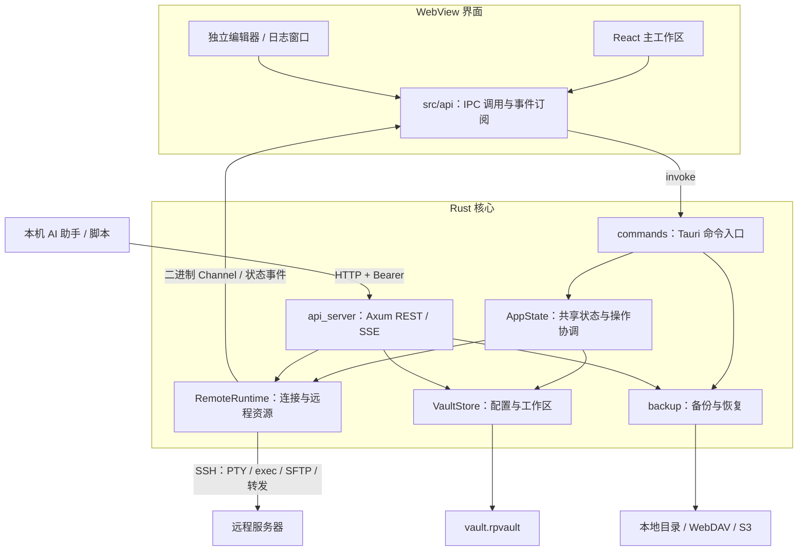
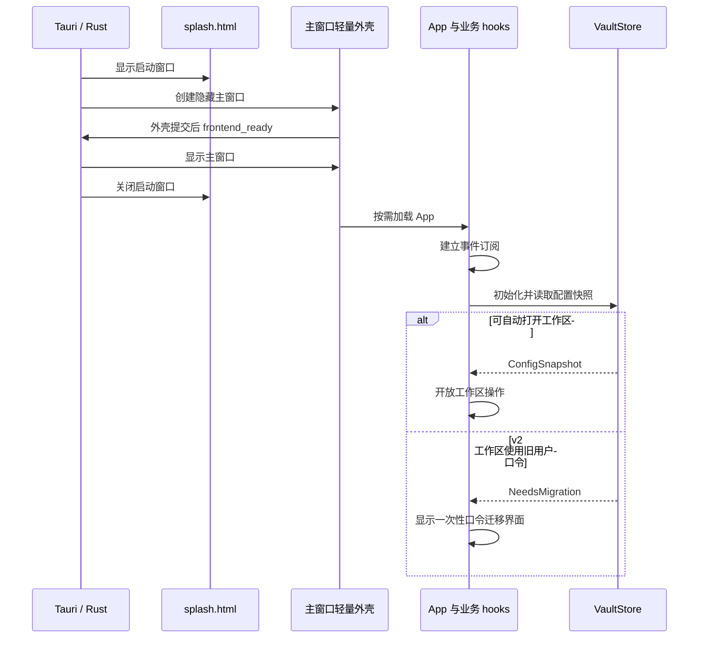
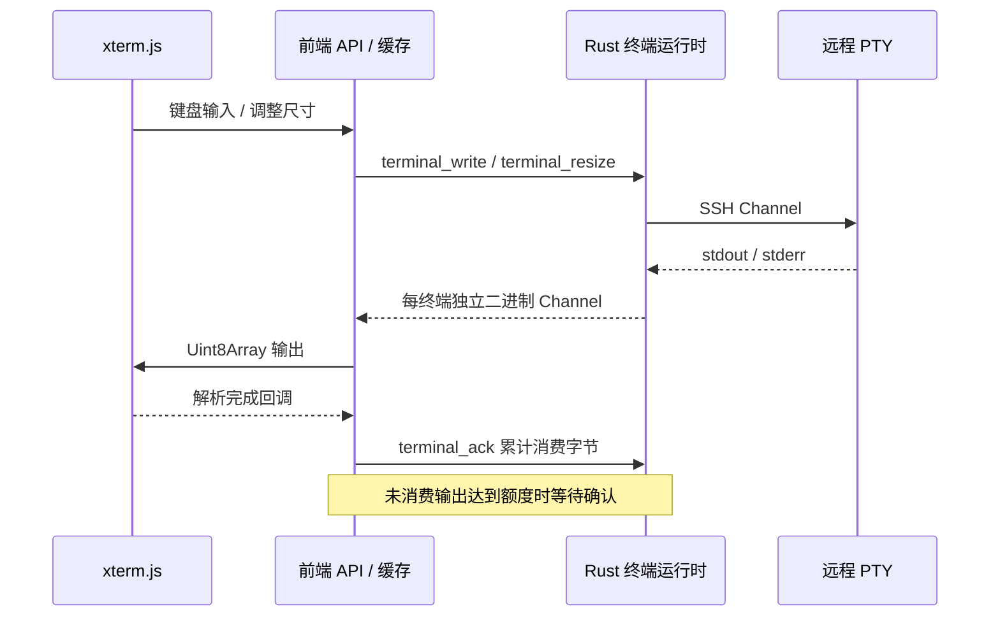
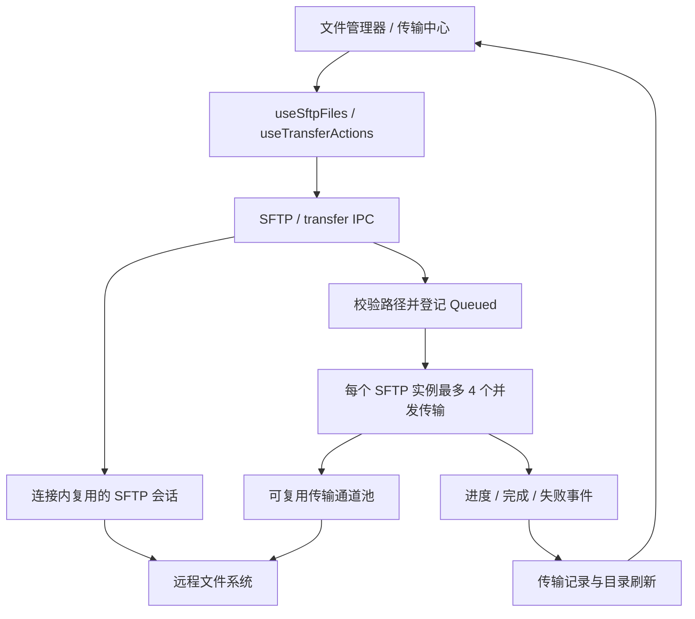
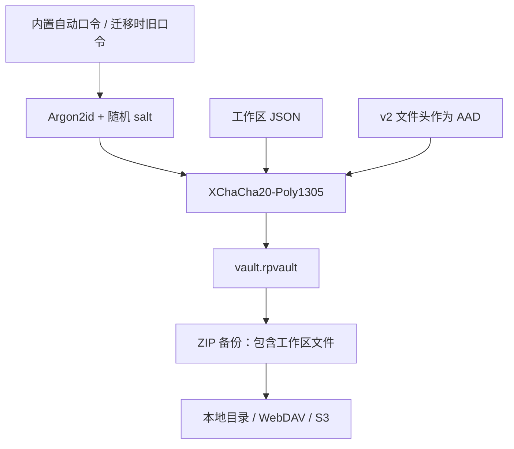
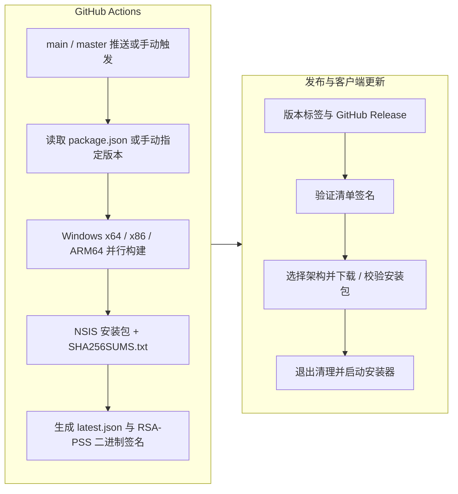

# HelM

基于 **Tauri 2、React 19 和 Rust** 的 Windows SSH / SFTP 桌面工作台，把多会话终端、远程文件管理、端口转发和本机自动化接口放在同一个应用中。

[](https://github.com/lookfeeb/Hlem_SSH/actions/workflows/release.yml)


[下载安装包](https://github.com/lookfeeb/Hlem_SSH/releases/latest) · [开发与测试](#开发与测试) · [系统架构](#系统架构) · [目录与清理](#目录与清理)

本文对应仓库版本 **0.0.57**。版本以 [package.json](package.json) 和 [Cargo.toml](src-tauri/Cargo.toml) 为准；发行工作流提供 Windows x64、x86、ARM64 安装包，其他平台目前没有对应发布流水线。

## 功能概览

| 功能 | 当前实现 |
| --- | --- |
| SSH 会话 | 分组、收藏、最近连接；密码 / 私钥认证；主机指纹确认；断线重连 |
| 终端 | 多会话 xterm.js、WebGL 渲染与回退、窗口尺寸同步、命令输入高亮、输出回放 |
| 远程文件 | SFTP 目录树与虚拟列表、搜索、创建 / 重命名 / 复制 / 删除、上传 / 下载 |
| 文本编辑 | CodeMirror 6、多语言语法高亮、远程保存、独立编辑器窗口 |
| 传输中心 | 并发队列、进度与历史记录、暂停 / 恢复 / 取消 |
| 网络与监控 | 本地 / 远程 / SOCKS5 动态转发；直连、SOCKS5、HTTP CONNECT 代理；服务器遥测 |
| 工作区与备份 | 本地 RPVAULT v2 工作区；手动与自动备份；本地目录、WebDAV、S3 |
| AI API | 仅监听本机的 SSH / SFTP REST 网关、OpenAPI、批量命令、长任务与 SSE、接口调试台 |
| 桌面集成 | 启动页、系统托盘、独立日志窗口、签名校验更新 |

工作区自动解锁采用内置固定口令。文件虽然经过加密，但不构成用户独有的保密保护；工作区和备份都应作为敏感数据保存，详见[工作区与安全边界](#工作区与安全边界)。

## 开发与测试

### 环境要求

- Windows，安装 Microsoft Edge WebView2 Runtime。
- Node.js **22.12+** 与 npm；Vite 8 的 Node 要求为 `^20.19.0 || >=22.12.0`，CI 使用 Node 22。
- Rust stable、MSVC 工具链，以及 Visual Studio Build Tools 的“使用 C++ 的桌面开发”工作负载和 Windows SDK。
- PowerShell 7（`pwsh`），用于仓库测试脚本。
- Python + `paramiko` 仅用于 SFTP 集成 / 性能测试，日常启动不需要。

在仓库根目录执行：

```powershell
npm ci
npm run tauri:dev
```

Tauri 会启动 `npm run dev`，Vite 固定监听 `http://127.0.0.1:5177`。`predev` 先运行 [free-port](tools/free-port/src/main.rs)，尝试释放本项目占用的 5177 端口。单独运行 Vite 只提供前端页面，SSH、文件系统和窗口功能需要 Tauri 运行环境。

### 常用命令

| 命令 | 用途 |
| --- | --- |
| `npm run tauri:dev` | 启动桌面开发环境 |
| `npm run build` | TypeScript 检查与 Vite 生产构建，输出到 `dist/` |
| `npm run tauri:build` | 构建桌面程序和安装包 |
| `npm run check:rust` | Rust 编译检查 |
| `cargo test --manifest-path src-tauri/Cargo.toml` | Rust 单元测试；不包含标记为 ignored 的集成 / 性能测试 |
| `node tools/check-startup-bundle.mjs` | 构建后检查首屏体积预算与按需加载边界 |

[build.ps1](build.ps1) 提供交互式构建和缓存清理。Cargo 的默认 release profile 已启用 thin LTO、单 codegen unit 和符号裁剪，脚本的“普通编译”仍沿用这组默认配置。

前端 `tests/` 测试源码及其运行脚本已移除。当前保留 TypeScript / 生产构建检查、Rust 单元测试、SFTP 集成测试和性能基准。

SFTP 集成与性能测试会启动临时本机服务：

```powershell
python -m pip install paramiko
npm run test:sftp-reuse
npm run test:sftp-performance
```

性能脚本支持 `-LatencyMs`、`-SizeMiB`、`-Parts`，具体参数见 [test-sftp-performance.ps1](tools/test-sftp-performance.ps1)。终端的浏览器基准和原生基准入口见[终端性能说明](docs/terminal-performance.md)。

## 系统架构

应用由 WebView 界面和 Rust 核心组成。桌面界面通过 Tauri IPC 调用业务命令；本机 API 通过 Axum 路由进入同一后端服务体系。SSH、SFTP、文件传输和密钥处理在 Rust 侧执行。



### 前端职责

| 位置 | 职责 |
| --- | --- |
| [src/main.tsx](src/main.tsx) | 轻量启动外壳；按 URL 选择主工作区、编辑器或日志窗口 |
| [src/App.tsx](src/App.tsx) | 组合布局、共享界面状态和业务 hooks |
| [src/app/](src/app/) | 启动、会话、终端、SFTP、传输、隧道、设置、备份、更新等业务流程 |
| [src/app/lazyComponents.tsx](src/app/lazyComponents.tsx) | 工作区和面板的按需加载；已打开面板保留本地状态 |
| [src/components/](src/components/) | 终端、文件管理器、编辑器、侧栏、对话框与独立窗口 |
| [src/api/](src/api/) | Tauri 调用封装、状态事件、终端 Channel 解码与消费确认 |
| [src/lib/](src/lib/) | 终端缓存、路径、配置快照、队列、状态合并与性能统计等通用逻辑 |
| [src/styles/](src/styles/) | 基础样式、布局及随功能加载的样式 |

业务状态由 React hooks 与专用状态函数管理。配置快照通过 revision 防止旧响应覆盖新配置；连接、目录和传输也各有处理异步竞态的状态逻辑。

### 后端职责

| 模块 | 职责 |
| --- | --- |
| [lib.rs](src-tauri/src/lib.rs) | Tauri 初始化、插件与命令注册、窗口 / 托盘、后台任务和退出清理 |
| [commands/](src-tauri/src/commands/) | 按领域拆分 IPC；`AppState` 协调配置变更、连接、备份与 API 生命周期 |
| [remote.rs](src-tauri/src/remote.rs) 与 [remote/](src-tauri/src/remote/) | `RemoteRuntime`、资源注册表与各类远程运行时 |
| `remote/runtime_connection.rs`、`runtime_registry.rs`、`lifecycle.rs` | 连接复用、资源查找、关闭和失效连接回收 |
| `remote/runtime_terminal.rs`、`terminal_stream.rs`、`terminal_bytes.rs` | PTY、终端输入输出、二进制帧与背压控制 |
| `remote/runtime_sftp.rs`、`runtime_transfer.rs`、`transfer.rs` | SFTP 会话复用、传输通道池、队列调度与数据读写 |
| `remote/runtime_forward.rs`、`runtime_telemetry.rs` | 端口转发与服务器指标采集 |
| [api_server/](src-tauri/src/api_server/) | Bearer 鉴权、授权会话、命令检查、REST、长任务、SSE 与接口文档 |
| [vault.rs](src-tauri/src/vault.rs)、[crypto.rs](src-tauri/src/crypto.rs) | 工作区读写、自动解锁、口令迁移及密码学实现 |
| [config.rs](src-tauri/src/config.rs)、[config_mutation.rs](src-tauri/src/config_mutation.rs)、[atomic_file.rs](src-tauri/src/atomic_file.rs) | 配置模型与校验、变更串行化、文件原子写入 |
| [backup.rs](src-tauri/src/backup.rs)、[http_client.rs](src-tauri/src/http_client.rs) | 备份存储目标与 HTTP 客户端复用 |
| [direct_broker.rs](src-tauri/src/direct_broker.rs) | Windows 一次性直连辅助进程，建连后把 socket 交给主进程 |

`remote/` 的拆分文件是同一运行时的模块，不是独立服务进程。桌面连接和自动化连接按来源区分，分别复用和回收，避免 API 停止时连带关闭桌面终端。

## 关键运行流程

### 启动与窗口



工作区初始化的文件读取和密码学运算在阻塞工作线程执行，并发请求共享初始化结果。主窗口显示不等待隐藏 WebView 的动画帧。独立编辑器与日志窗口加载各自入口；系统托盘和窗口控制由 Rust 管理。

Windows 非回环目标直连会尝试启动一次性 broker，使用随机令牌回连父进程并移交 socket；失败后回退到主进程建连。它不是常驻代理服务。

### SSH 与资源生命周期

1. `useSessionRuntime` 调用 `ssh_connect`，后端读取会话、代理与受信任主机指纹。
2. `RemoteRuntime` 按会话和连接来源串行协调建连，复用仍有效的连接。
3. SSH 握手检查主机密钥，未知或不匹配的指纹需要用户核实；信任写入后再重试连接。
4. 认证成功后返回 `connectionId`，终端、SFTP、遥测按需申请各自资源。
5. 断开时释放对应终端、SFTP、传输、遥测和转发；后台每 30 秒巡检失效连接。

`sessionId` 是保存的会话配置标识；`connectionId` 是运行中的 SSH 连接标识；`terminalId`、`sftpId` 等对应具体资源，不能混用。自动重连还受前端状态和重试次数限制。

### 终端数据与背压



终端输出使用 Tauri 原生 Channel / Raw 响应，数据帧保留原始字节，stdout、stderr、系统提示和关闭通知按通道顺序处理。普通状态变化继续使用 Tauri 事件。

- 持续输出按 **8 ms / 64 KiB** 合并，交互后首批输出和空闲后首包优先发送。
- 每终端允许最多 **1 MiB** 未消费输出；前端解析后确认，形成背压，避免生产速度长期超过消费速度。
- 回放缓存与 GPU 渲染器分别设置容量上限；后台终端继续解析输出，切回后恢复展示。
- WebGL 加载失败或上下文丢失时回退；目录识别和提示符高亮复用 xterm 的解析结果。

具体内存上限、性能数据与复现步骤见[终端性能说明](docs/terminal-performance.md)。

### SFTP 与文件传输



目录访问与文件数据传输使用各自的复用路径。任务完成覆盖 / 源文件检查后先登记排队并返回，后台再调度传输；每个 SFTP 实例最多接受 128 个未结束任务。传输控制包含暂停、恢复与取消，记录合并会防止延迟响应覆盖较新的完成状态。

[russh-sftp 的本地副本](vendor/russh-sftp/) 通过 Cargo 的 `[patch.crates-io]` 接入，包含项目依赖的 SFTP 读管线能力，是构建输入。

### 端口转发

| 类型 | 数据方向 |
| --- | --- |
| 本地转发 `-L` | 本地监听端口 → SSH 通道 → 远程可访问的目标 |
| 远程转发 `-R` | 远端 sshd 监听端口 → SSH 通道 → 本地可访问的目标 |
| 动态转发 `-D` | 本地 SOCKS5 请求 → SSH 通道 → 请求指定的目标 |

隧道配置保存在工作区，运行实例由 `runtime_forward` 管理。实际监听范围和目标可达性还取决于配置、远端 sshd 策略与网络环境。

## 工作区与安全边界

### 格式与存储

默认工作区为 Tauri 应用配置目录中的 `vault.rpvault`；可通过 `HELM_VAULT_PATH` 指定其他文件，界面提供打开数据目录入口。

当前读写与备份导入仅支持 **RPVAULT v2 二进制格式**。`MigrationGate` 处理的是 v2 工作区从旧用户口令迁移到自动解锁，不提供 v1 文件格式转换。



| 机制 | 实际保护范围 |
| --- | --- |
| 工作区加密 | XChaCha20-Poly1305，24 字节 nonce；文件头参与认证，检测密文或元数据篡改 |
| 自动解锁 | 使用程序内置固定口令与较低成本 KDF；不能阻止拿到文件及程序实现的人解密 |
| 旧口令迁移 | 用户提供旧口令解开 v2 工作区，再转为自动解锁 |
| 备份 | ZIP 中保存工作区文件；不会另加一层用户独有口令保护 |
| SSH | 通过 SSH 加密远端通信，并检查保存的主机指纹 |
| 内存清理 | 工作区释放时清零持有的密钥与 salt；不等于所有业务数据副本都被清零 |
| 更新验证 | RSA-PSS / SHA-256 验证清单签名，再按清单校验安装包哈希和大小 |

因此，不应公开上传工作区或备份。系统账户权限、备份目标权限和设备保护仍是当前存储方案的重要边界。

## AI API 本地网关

这是提供远程操作能力的本机 REST 网关，不提供模型推理。服务随 HelM 运行，仅绑定 **`127.0.0.1`**，默认端口 **19880**。

在设置的 **AI API 控制** 中选择允许访问的会话并启动服务，按需开启随应用自动启动。调用时使用面板给出的 API Key；包括接口文档在内的请求都需要 `Authorization: Bearer <api_key>`。首次 SSH 主机信任仍需在桌面端完成。

### 接口入口

| 入口 | 用途 |
| --- | --- |
| `GET /api/auth` | 验证 API Key |
| `GET /openapi.json`、`GET /api/fields` | OpenAPI 3.1 与动态字段 / 调用规则；支持 ETag 缓存 |
| `GET /api/sessions` | 查询授权会话 |
| `POST /api/connect`、`POST /api/disconnect` | 自动化连接生命周期 |
| `POST /api/exec`、`POST /api/exec/batch` | 单条 / 批量执行命令 |
| `/api/jobs`、`/api/jobs/{job_id}` | 创建、查询长任务，订阅 `/events` 或请求 `/cancel` |
| `/api/files`、`/api/files/page`、`/api/files/stat` | 目录列表、分页与文件元数据 |
| `PUT /api/upload`、`GET /api/download` | 原始文件字节流上传 / 下载 |
| `/api/tunnels` | 隧道配置与启动 / 停止 |
| `/api/backup/settings`、`/api/backup/records`、`/api/backup/run` | 备份设置、记录及立即备份 |

具体请求方法、字段和返回结构以运行中服务的 `/openapi.json` 为准。内置接口调试台支持普通请求与 SSE，可复制 PowerShell cURL。

```powershell
$helmHeaders = @{ Authorization = "Bearer <api_key>" }
$helmBaseUrl = "http://127.0.0.1:19880"

# 先读取授权会话和接口说明
Invoke-RestMethod -Headers $helmHeaders -Uri "$helmBaseUrl/api/sessions"
Invoke-RestMethod -Headers $helmHeaders -Uri "$helmBaseUrl/openapi.json"

# 使用返回的 sessionId 执行命令
$helmBody = @{
    sessionId = "<session_id>"
    command = "uname -a"
    safetyMode = "balanced"
} | ConvertTo-Json
Invoke-RestMethod -Method Post -Headers $helmHeaders `
    -ContentType "application/json" -Body $helmBody `
    -Uri "$helmBaseUrl/api/exec"
```

长任务支持 stdout / stderr 事件流、状态查询和取消；SSE 断线后可使用 `Last-Event-ID` 在保留的事件历史内恢复。命令检查支持 `balanced`、`strict`，属于规则检查，不能替代操作系统权限或命令隔离。API Key 同时可访问所开放的管理端点，应仅交给可信的本机调用方。

## 构建与更新

主要依赖为 React 19、Ant Design 6、TypeScript 6、Vite 8、xterm.js 6、CodeMirror 6，以及 Tauri 2、Tokio、russh 0.60、russh-sftp 2.1、Axum 0.8。准确版本由 npm / Cargo 锁文件记录。

[Windows Release](.github/workflows/release.yml) 在推送到 `main` / `master` 或手动触发时执行，流程如下：



发布配置使用仓库变量 `HELM_UPDATE_PUBLIC_KEY_PEM` 和仓库 Secret `HELM_UPDATE_PRIVATE_KEY_PEM`。工作流默认采用 `package.json` 版本，不会自动递增版本号。

安装更新使用 `latest.json` 与 `latest.json.sig.bin`，不再兼容旧文本 `.sig`。本地构建若要使用签名更新，应提供对应更新仓库和公钥；发布工作流通过 `HELM_UPDATE_REPO` 指定当前仓库。

更新清单、签名或安装包直接下载失败时，客户端会通过 GitHub 官方 Release Assets API 回退下载，无需第三方镜像。清单与签名从同一次 Release 查询结果中配对获取，安装包按原版本标签查找；回退后仍校验清单签名和安装包 SHA256。两个入口都失败时，错误信息会分别显示直接下载与 API 回退的失败原因。

`.cargo/config.toml` 将本地 Cargo 编译缓存及产物统一放到 `Z:/HelmBuildCache/target/`，主程序和 Rust 工具共用此目录。本机构建安装包通常位于 `Z:/HelmBuildCache/target/release/bundle/`；显式传入 target 时位于该缓存目录下的 `<rust-target>/release/bundle/`。`build.ps1` 会读取 Cargo 实际目录来查找产物和清理缓存。Z 盘需保持可访问；其他机器可用 `CARGO_TARGET_DIR` 覆盖路径，GitHub Actions 已覆盖为仓库根 `target/`。

## 目录与清理

```text
Helm/
├── src/                       # React 界面、业务 hooks、IPC 和前端工具
├── src-tauri/
│   ├── src/                   # Rust 命令、远程运行时、API、工作区与备份
│   ├── capabilities/          # Tauri 权限
│   ├── icons/                 # 原生应用与安装包图标
│   └── tauri.conf.json        # 窗口、启动页、CSP 与打包配置
├── public/
│   ├── splash.html            # Tauri 启动窗口页面
│   └── Helm_icon.svg          # WebView 使用的品牌图标
├── tools/                     # 测试脚本、性能基准、端口清理工具
├── vendor/russh-sftp/          # Cargo patch 引用的 SFTP 源码
├── docs/                      # 性能策略、启动分析与终端实测
├── .github/workflows/         # Windows 构建与发布
├── .cargo/config.toml         # Cargo 产物路径配置
├── build.ps1                  # 交互式构建 / 缓存清理
├── package.json               # npm 脚本与前端依赖
└── vite.config.ts             # 开发端口、构建与拆包配置
```

### 静态资源 `public/`

**`public/` 是应用运行资源，必须保留。**

| 路径 | 引用与作用 | 清理结论 |
| --- | --- | --- |
| `public/splash.html` | [tauri.conf.json](src-tauri/tauri.conf.json) 的 `splash` 窗口直接加载 | 是启动资源；删除会使启动窗口失去页面 |
| `public/Helm_icon.svg` | `splash.html`、[index.html](index.html)、主窗口启动外壳、顶栏、迁移页、关于页和 API 调试台引用 | 是界面资源；删除会导致图标加载失败 |

Vite 构建会把 `public/` 原样复制到 `dist/` 根目录，再由 Tauri 打包；这里的 SVG 与 `src-tauri/icons/` 分别服务 WebView 和原生应用，不能互相直接替代。

### 可再生的产物

以下目录存在时可以清理，但应等相应开发、构建或测试进程结束：

| 路径 | 删除后的恢复方式 |
| --- | --- |
| `dist/` | `npm run build` |
| `Z:/HelmBuildCache/target/`、旧 `target/`、`src-tauri/target/`、工具的 `target/` | 下次 Cargo 构建重新生成；会失去编译缓存 |
| `.vite/`、`node_modules/.vite/`、`node_modules/.vite-temp/` | 下次 Vite 启动或构建重新生成 |
| `playwright-report/`、`test-results/` | 历史测试输出；当前构建不依赖这些目录 |
| `node_modules/` | `npm ci`，需要重新安装依赖 |

工作区 `vault.rpvault`、用户备份、源码、依赖锁文件、原生图标及 `vendor/russh-sftp/` 都不属于上述缓存。

## 更多说明

- [性能策略与验证](docs/performance.md)：启动、终端、文件列表、传输和 API 的优化路径。
- [启动调查记录](docs/startup-investigation.md)：启动阶段与度量方法。
- [终端性能说明](docs/terminal-performance.md)：二进制通道、解析 / 渲染、基准与验证边界。

## 许可

项目原说明声明采用 MIT；当前仓库未附独立 `LICENSE` 文件。第三方依赖及 vendored 代码遵循各自许可。
